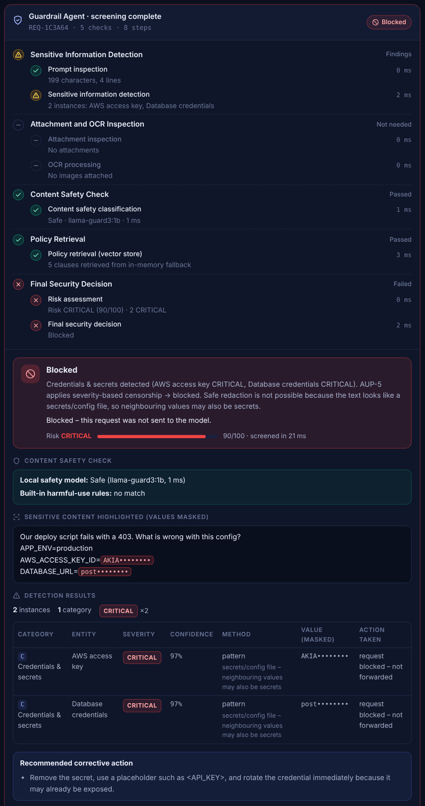
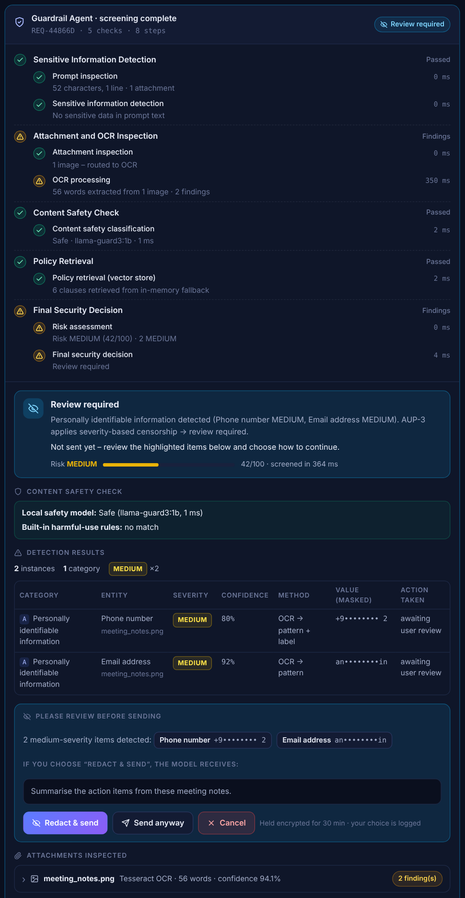
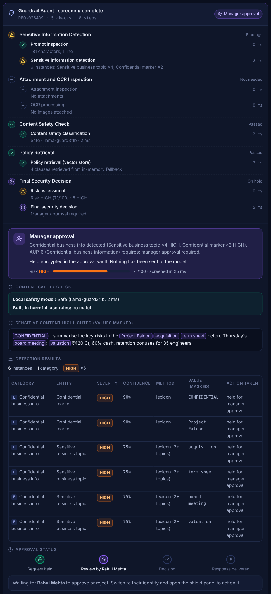
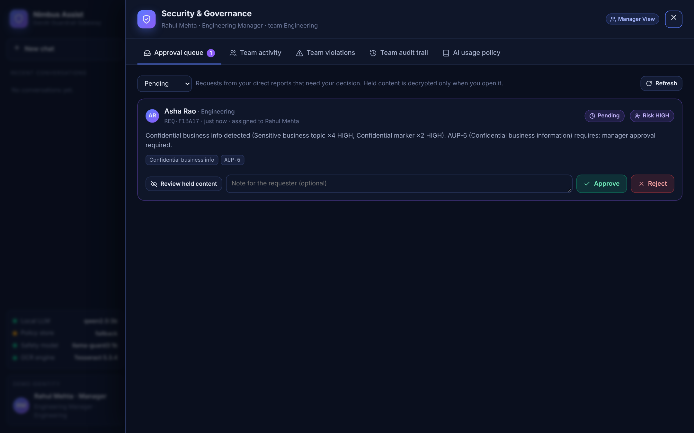
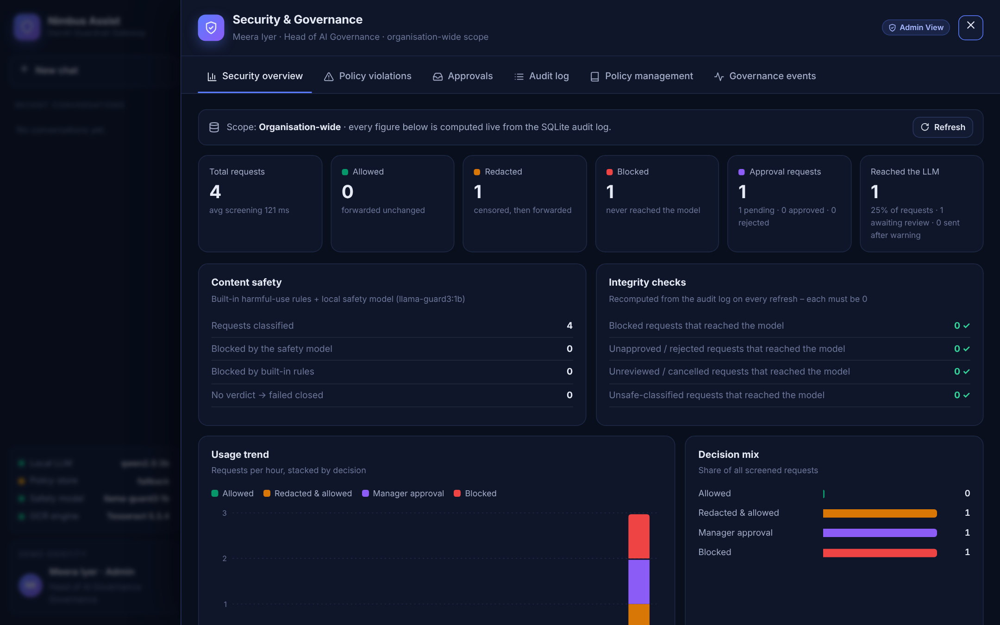

# GenAI Guardrail Gateway

**AI Usage Governance Agent** · Agent Forge: Agentic AI Hackathon · **PS16** · Data Privacy, Security & Governance

    

A chat assistant with a security agent built in. Employees use AI as usual. Before any prompt or attachment reaches the local model, the **Guardrail Agent** checks it for secrets, personal data, confidential content and unsafe requests. It then **allows**, **redacts**, **blocks** or **holds the request for a manager**, and logs every decision.

**Team 3Musketeers:** Ramyaa Nagotia (1CR24CS144) · Shreya Tumari (1CR24CS174) · Tasmai S Dath (1CR24CS200)

---

## The problem

Employees paste source code, customer records, passwords and confidential plans into AI tools every day. Banning AI doesn't work, and governance teams have no visibility into what is being shared.

## Our solution

```
Employee ─► Chat UI ─► Guardrail Gateway ─────────────────────────► Qwen 2.5 (local assistant)
                         ① Sensitive information detection            ▲ only screened text,
                         ② Attachment + OCR inspection                │ only with a signed ticket
                         ③ Content safety check ───────────────► Llama Guard 3 (local classifier)
                         ④ Policy retrieval ◄── ChromaDB (AI usage policy)
                         ⑤ Final decision ──► SQLite audit log · encrypted approval vault
                         ▼
              🛡️ Shield dashboard: employee · manager · admin views
```

| Decision | When | What happens |
|---|---|---|
| ✅ **ALLOW** | Nothing sensitive | Prompt goes to the model unchanged |
| ✂️ **REDACT & ALLOW** | Personal data, IDs, a single secret | Values become placeholders such as `[AADHAAR NUMBER REDACTED]`; only the censored text is sent |
| ⛔ **BLOCK** | Secrets files, harmful requests, unreadable files | Nothing is sent; the user sees the policy clause and how to fix it |
| 👤 **MANAGER APPROVAL** | Confidential plans, source code, bulk records | Held encrypted until the assigned manager approves it; it's re-screened, then released once |

**What makes it trustworthy:**
- **Fails closed.** If a file can't be read, the safety model gives no verdict, or a policy clause is missing, nothing is forwarded.
- **Rules decide, not the LLM.** Prompt injection can't talk the gateway into allowing something.
- **No raw secrets are ever stored.** The audit log keeps masked metadata only.

## Screenshots

| Redact & allow | Block | Image OCR |
|---|---|---|
|  |  |  |
| **Approval request** | **Manager queue** | **Admin dashboard** |
|  |  |  |

<sub>All data is synthetic. The screenshots were captured with the test stand-in for Ollama and the in-memory policy store.</sub>

## Quick start

You need **Python 3.10+**. Everything else is set up for you.

```bash
git clone https://github.com/tas7129/genai-guardrail-gateway.git
```

Then double-click **`Start Guardrail Gateway.command`** (macOS) or **`Start Guardrail Gateway.bat`** (Windows), or run `python3 launcher.py`.

The launcher:
1. installs the Python packages;
2. starts Ollama, or offers to install it;
3. downloads Qwen 2.5 3B and Llama Guard 3 1B (about 3.5 GB, once);
4. checks Tesseract OCR;
5. opens **http://127.0.0.1:8000**.

On macOS, the first time: right-click the file → **Open** → **Open**.

**Try it:** click a demo card on the welcome screen, then **Send**. Switch identity at the bottom left to **Rahul** (manager) to approve requests, or to **Meera** (admin) for the full dashboard.

For manual and Windows setup, see [WINDOWS_SETUP.md](WINDOWS_SETUP.md).

## Tech stack

| Layer | Technology |
|---|---|
| Frontend | HTML, CSS, vanilla JS. No build step; works offline |
| Gateway | Python, Starlette, Uvicorn; streams real screening steps live |
| Local models | Ollama: **Qwen 2.5 3B** (assistant) + **Llama Guard 3 1B** (safety classifier) |
| Policy | **ChromaDB**: 22 governing clauses + 27 reference clauses |
| OCR | **Tesseract** (multi-pass: rotation, upscaling, contrast) |
| Detection | 89 entity types: patterns, checksums (Luhn, Verhoeff), context rules |
| Storage | **SQLite** audit log; Fernet-encrypted approval vault; HMAC-signed forward tickets |

## Results

- **Tests: 353 automated tests, including 99 security-audit cases.** They prove that blocked, pending and unapproved requests never reach the model, and that redacted requests send only placeholders. Run them with `pytest -q`; no models are needed.
- **Benchmarks on the hackathon datasets (held-out splits):**
  - Secret detection F1: **0.56 → 0.77** (CredDetX).
  - Core personal-data recall: **54 % → 83 %** (NVIDIA Nemotron-PII).

## Repository

```
backend/     gateway, screening pipeline, decision engine, safety model client, approvals, audit DB
frontend/    chat UI + governance dashboard
policy/      AI usage policy, safety categories, severity levels
tests/       pytest suite + security audit cases
scripts/     smoke test, model check, audit runner, dataset tools
samples/     synthetic demo files (images, CSV, code)
docs/        technical details, demo script, screenshots
```

**More detail:**
- [Technical details](docs/TECHNICAL_DETAILS.md): design, detection rules, security model, datasets, limitations
- [Security audit](audit_report/FINDINGS.md)
- [Dataset evaluation](dataset_audit/test_report.md)

## Known limitations

- **Pattern-based detection still misses some values.** About 15–17 % of sensitive values in the benchmarks get through, mostly free-text names and foreign addresses. NER-based detection is the next step.
- **Llama Guard 3 1B is small.** It can miss reworded or non-English requests. The 8B model is more accurate.
- **The demo identity switcher is for presentations.** Use PIN mode (`GG_AUTH_MODE=pin`) otherwise.

---
<sub>All names, numbers, keys and company details in this repository are synthetic.</sub>
